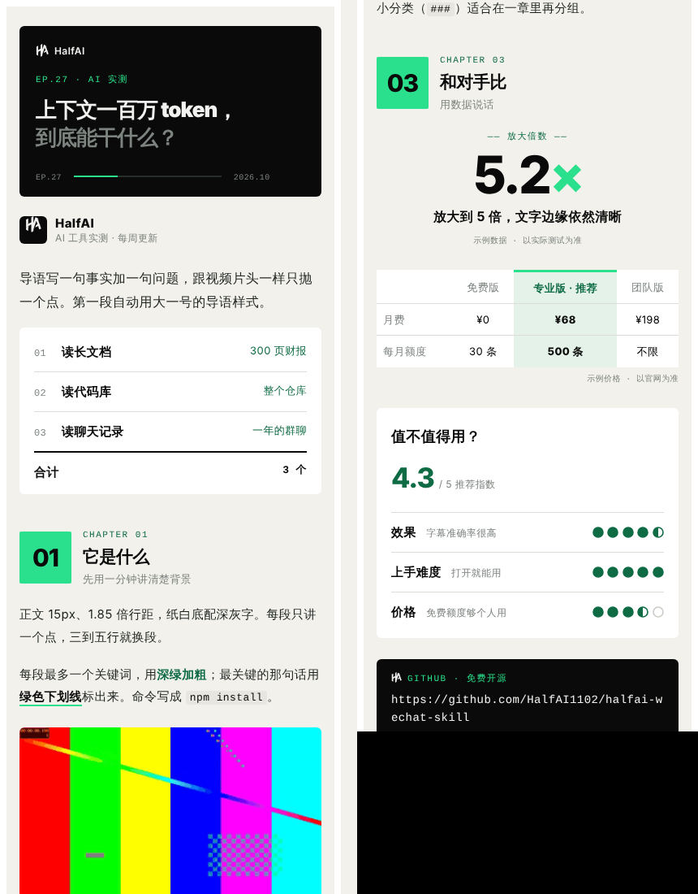

# halfai-wechat-skill

HalfAI 的公众号图文排版 skill：Markdown 稿件 → 墨黑 / 纸白 / Half 绿风格、全内联样式、图片内嵌的公众号 HTML，外加一个带「复制排版」按钮的预览页。



## 安装

- **Claude Code**：把整个仓库放到 `~/.claude/skills/halfai-wechat-layout/`（或项目里的 `.claude/skills/halfai-wechat-layout/`）。
  ```bash
  git clone https://github.com/HalfAI1102/halfai-wechat-skill ~/.claude/skills/halfai-wechat-layout
  ```
- **claude.ai / 其他支持 Skills 的客户端**：把仓库打成 zip 上传。
- **其他 agent（Codex、Cursor、WorkBuddy、自建 agent…）**：让它先读 `SKILL.md`（`AGENTS.md` 也指向它），再按里面的流程跑 `scripts/build.py`。

入口是 `SKILL.md`。依赖只有 Python 3（标准库）；做 GIF 需要 ffmpeg，装了 gifsicle 会更小。

## 30 秒上手

```bash
python3 scripts/build.py examples/demo/article.md --name demo
open examples/demo/demo-preview.html   # 点「复制排版」，粘贴到公众号后台
```

稿件语法见 [`references/components.md`](references/components.md)，示例稿 [`examples/demo/article.md`](examples/demo/article.md) 用到了全部组件。
